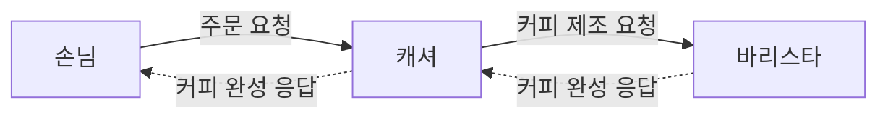

# 1. 협력하는 객체들의 공동체

객체지향을 이해하기 위해 커피 주문 과정을 먼저 살펴보기

- 커피를 주문하는 손님, 주문을 받는 캐셔, 커피를 제조하는 바리스타 셋의 역할, 책임, 협력으로 이뤄짐

- 커피 주문이라는 공동의 목표를 달성하기 위해 각자 맡은 **역할(Role)**과 **책임(Responsibility)**을 수행하며 **협력(Collaboration)**함

| 현실 세계            | 객체 지향 |
| -------------------- | --------- |
| 사람                 | 객체      |
| 요청과 응답          | 메시지    |
| 요청을 처리하는 방법 | 메서드    |

# 2. 이상한 나라의 객체

## 1. 객체(Object)

- 상태(State), 행동(Behavior), 식별자(Identity)를 지닌 자율적인 존재

    - 식별 가능한 물리적인 또는 개념적인 사물은 어떤 것이라도 객체가 될 수 있음

    - 데이터와 프로세스를 객체라는 하나의 틀 안에 묶어서 자율성 보장 (유지보수가 쉽고 재사용이 용이)

### 1.1 상태(State)

- 특정 시점에 객체가 가지고 있는 정보의 집합으로 객체의 구조적 특징을 표현
- 행동의 결과는 현재 상태에 의존. 과거의 모든 행동을 기억하는 대신 현재 상태를 통해 행동의 결과 예측 가능

- 앨리스가 현재 음료를 들고 있는 상태인지 표현하고 싶다면?
  → 앨리스의 상태 일부를 음료라는 객체를 이용하여 표현 (음료에 관해 알지 못하는 상태로 변경)

- 객체의 상태는 프로퍼티(Property)와 프로퍼티 값(Property Value)로 구성
- 프로퍼티는 변경되지 않고 고정되기 때문에 정적이지만, 프로퍼티 값은 시간에 따라 변경되므로 동적

#### 프로퍼티(Property)

- 객체의 상태를 구성하는 특징으로, 두 가지로 구분됨
- 모든 객체의 상태는 단순한 값과 객체의 조합으로 표현 가능

| 구분            | 설명                                                         | 예시                                                         |
| --------------- | ------------------------------------------------------------ | ------------------------------------------------------------ |
| 속성(Attribute) | 단순한 값으로 표현되는 특징                                  | 앨리스의 키, 위치 같은 숫자, 문자열, 양, 속도, 시간, 참/거짓 등 |
| 링크(Link)      | 다른 객체를 참조하는 관계 (다른 객체의 식별자를 알고 있어야 함, 링크가 있어야 메세지 전송 가능) | 앨리스와 음료의 연결                                         |

### 1.2 행동 (Behavior)

- 객체가 외부 요청에 응답하기 위해 수행하는 행동
    - 객체는 행동을 통해 다른 객체와 협력하며, 이 행동은 외부에 가시적이어야 함
    - 상태가 행동에 영향 : 동일한 행동이라도 현재 상태에 따라 결과가 달라질 수 있음
    - 행동은 상태를 변경 : 부수 효과(Side Effect)
- 객체의 행동으로 발생하는 결과
    - 자신의 상태 변경
    - 다른 객체에게 메시지 전송
        - 다른 객체의 상태에 직접 접근 불가하기 때문에 간접적으로 다른 객체 상태를 변경

### 1.3 식별자 (Identity)

- 모든 객체는 식별자를 가지며, 이는 다른 객체와 구별하는 고유한 프로퍼티
    - 객체는 어떤 상태에 있더라도 유일하게 식별 가능

#### 값과 객체의 차이

| 구분      | 값                                                           | 객체                                       |
| --------- | ------------------------------------------------------------ | ------------------------------------------ |
| 식별자    | 없음                                                         | 있음                                       |
| 상태      | 불변 - 숫자, 문자열, 날짜, 시간, 금액과 같은 변하지 않는 양을 모델링 | 변경 가능 - 시간과 행동에 따라 상태가 변경 |
| 비교 기준 | 동등성(Equality)                                             | 동일성(Identity)                           |
| 판단 방법 | 상태가 같으면 같은 값                                        | 상태가 달라도 같은 식별자라면 같은 객체    |

- 값이 불변인 이유 : 키 = 180 일때, 180이라는 값 자체는 변하지 않으나 키 = 185로 변경은 가능. 이는 180이 185로 변한 것이 아니라, 새로운 값을 할당한 것
- 참조 객체(reference object) 또는 엔티티(Entity)는 식별자를 지닌 전통적인 의미의 객체

## 2. 객체의 자율성과 캡슐화

- 객체는 자신의 상태와 행동을 스스로 관리하는 자율적인 존재
    - 객체 내부와 외부를 명확히 구분하여 외부의 간섭 제한
    - 무엇을 하는지는 알 수 있지만, 어떻게 하는지는 알 수 없어야 함
    - 허용된 수단을 통해서만 의사소통

### 2.1 상태 캡슐화(Encapsulation)

- 객체의 상태를 외부에 노출하지 않고 행동을 통해 상태를 관리하도록 함

- 앨리스가 음료를 마시는 과정에서 이뤄지는 앨리스와 음료의 협력 관계
    - 메시지를 전달하는 외부의 객체는 수신 객체의 상태가 변경되는 사실을 알 수 없고, 메시지를 해석하고 반응해서 상태를 변경할지 여부는 수신자의 판단에 따름
    - 객체의 자율성을 높이고 협력을 단순하고 유연하게 만듦

### 2.2 기계로서의 객체

- 객체는 내부 구조를 알 수 없는 블랙 박스와 같음
- 외부에서는 객체가 제공하는 버튼(인터페이스)를 통해서만 상호작용 (캡슐화 강화)
    - 쿼리(query) : 객체의 상태를 조회하는 작업
    - 명령(command) : 객체의 상태를 변경하는 작업

## 3. 협력과 메시지

"어떤 객체도 섬이 아니다" - 워드 커닝험, 켄트 백

- 객체는 혼자 시스템의 기능을 구현하지 않고 다른 객체와 협력

### 3.1 협력(Collaboration)

- 객체들이 공동의 목표를 달성하기 위해 상호 작용
- 객체들은 협력에서 맡은 역할과 책임 수행
- 협력은 객체들 사이의 연쇄적인 요청과 응답으로 구성

### 3.2 메시지(Message)

- 다른 객체와 협력을 위해 메시지를 주고 받음
- 송신자(Sender) : 메세지 전송 객체
- 수신자(Receiver) : 메시지 수신 객체

### 3.3 메서드(Method)

- 객체가 수신된 메세지를 처리하는 방법
    - 클래스에 정의된 함수나 프로시저를 통해 구현
    - 메시지를 수신한 객체가 실행 시점에 적절한 메서드 선택 가능
    - 같은 메세지라도 객체마다 다른 방식으로 처리 가능

| 구분   | 의미             |
| ------ | ---------------- |
| 메시지 | 무엇을 할 것인가 |
| 메서드 | 어떻게 할 것인가 |

- 메시지와 메서드를 분리함으로 객체의 자율성과 캡슐화 보장

## 4. 역할과 책임

객체는 협력을 위해 특정한 역할(Role)을 맡고, 역할에 적합한 책임(Responsibility)을 수행

### 4.1 책임

- 객체가 협력 속에서 수행해야하는 행동이나 제공해야하는 기능

### 4.2 역할

- 협력 안에서 객체가 수행해야하는 책임들
    - 여러 객체가 동일한 역할을 수행할 수 있음
    - 역할은 대체 가능성을 의미 : 동일한 역할을 수행한다면 다른 객체로 대체 가능
    - 책임을 수행하는 방법은 자율적으로 선택 가능 : 동일한 역할에 다른 방식으로 응답하는 다형성
    - 한 객체가 동시에 여러 역할을 수행할 수 있음

## 5. 책임 주도 설계 (RDD)

- 행동이 상태를 결정한다
    - 객체의 상태가 아니라 행동에 초점을 맞춰서 객체를 선정
    - 객체의 행동은 협력에서 수행해야하는 책임에 의해 결정

## 6. 객체지향과 현실 세계

### 의인화(Anthropomorphism)

- 현실에서는 수동적인 사물에 자율적인 행동과 책임을 부여하는 것
    - 객체는 자신의 상태를 스스로 관리
    - 다른 객체의 요청에 능동적으로 응답할 수 있음

### 은유(Metaphor)

- 현실 세계의 개념을 빌려 소프트웨어 객체를 표현하는 것
    - 현실을 그대로 모방하는 것이 아님
    - 현실의 개념을 활용해 이해하기 쉬운 객체 모델을 만듦

**객체지향은 현실 세계를 모방하는 것이 아니라, 현실의 개념을 은유하고 객체를 의인화하여 새로운 세계를 창조하는 것.**

## 7. 객체지향의 본질

- 시스템을 상호작용하는 자율적인 객체의 공동체로 바라보고 객체를 이용해 시스템을 분할
- 자율적인 객체란 상태와 행위를 함께 지니며 스스로 자기 자신을 책임지는 객체
- 객체는 시스템의 행위를 구현하기 위해 다른 객체와 협력. 각 객체는 협력 내에서 정해진 역할을 수행하며 역할은 관련된 책임의 집합.
- 객체는 다른 객체와 협력하기 위해 메시지를 전송하고, 메시지를 수신한 객체는 메시지를 처리하는 데 적합한 메서드를 자율적으로 선택