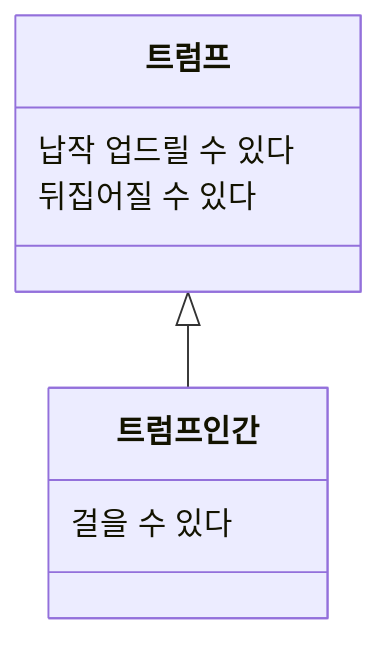

# 03. 타입과 추상화

| 실제 지도                                                                                                                   | 추상화된 지도                                                                                         |
| ----------------------------------------------------------------------------------------------------------------------- | ----------------------------------------------------------------------------------------------- |
|  |  |

- 지하철을 사용하는데에 있어 중요한 것은 어떤 역에서 다른 역까지 가는 것
- 지하철 이용자에게 실제 그 경로를 알려주는것은 불필요하다 (길이 구불구불하거나, 산이나 강을 지나가는지는 중요하지 않다)
- 지도의 정확성을 버리고 **추상화**를 함으로서 **목적**에 집중한 것

## 1. 추상화를 통한 복잡성 극복

- 추상화 : 현실에서 출발하되 불필요한 부분을 도려내며 사물의 본질을 드러내게 하는 과정
    - 지하철 노선도는 실제 역간 거리, 지리 정보 등을 제거하고, 어떤 역에서 다른 역까지 경로를 가장 잘 보여주고 있음
- 추상화는 두 차원에서 이루어짐
    - 1. 구체적인 사물들 간의 공통점을 취하고, 차이점을 버리는 일반화를 통해 **단순하게**
    - 2. 중요한 부분을 강조하기 위해 불필요한 세부 사항을 제거함으로서 **단순하게**

## 2. 객체지향과 추상화

- 앨리스 이야기에 수많은 객체가 등장하지만, 차이점을 무시하고 공통점만 취하여 ‘기껏해야 트럼프’로 단순화
    - 이야기에서 정원사, 병사들, 공주, 왕자, 토끼, 왕과 여왕 모두 객체
    - 토끼를 제외하고 나머지는 트럼프라는 공통점으로 단순화할 수 있음
- 객체지향 패러다임에서의 객체 : 명확한 경계를 가지고 서로 구별할 수 있는 구체적인 사람이나 사물
- 개념 : 공통점을 기반으로 객체들을 묶기 위한 그릇
    - 길거리를 다니는 빠른 교통 수단에 대해 자동차, 하늘을 나는 교통수단을 비행기 등
- 개념을 이용하면 객체를 여러 그룹으로 분류 가능

### 개념의 세가지 관점

- 개념의 세 가지 관점
    - 심볼 : 개념을 가리키는 간략한 이름, 명칭
    - 내연 : 개념을 완전한 정의, 내연의 의미를 이용해 객체가 개념에 속하는지 여부 확인 가능
    - 외연 : 개념에 속하는 모든 객체 집합
- 앨리스 이야기에서
    - 심볼 : 트럼프
    - 내연 : 몸이 납작하고 두 손과 두 발은 네모 귀퉁이에 있는 등장인물
    - 외연 : 정원사, 병사, 왕, 여왕 등

### 객체를 분류하기 위한 틀

- 객체에 적용할 **개념**을 결정하는 것은, 객체를 개념이 적용된 객체 집합의 일원으로 맞아들인다는 것
- **분류**는 특정한 개념의 객체 집합에 포함시키거나 포함시키지 않는 일

### 분류는 추상화를 위한 도구

- 추상화의 첫 번째 차원, 구체적인 사문간의 공통점은 취하고, 차이점은 버리는 일반화를 통해 단순화
- 추상화의 두 번째 차원 , 중요한 부분을 강조하기 위해 불필요하가 세부 사항을 단순화
- 개념은 복잠석응 극복하기 위한 추상화의 도구

## 3. 타입

- 타입
    - 개념이라는 단어는 일상생활적 용어
    - 타입은 개념을 컴퓨터 공학적인 요어로서 정의한 것
- 데이터 타입
    - 컴퓨터에 기록되는 데이터는 0과 1의 조합, 이를 구분하기 위해 프로그래밍 언어에서는 타입 시스템 탄생
    - 타입 시스템은 데이터가 어떻게 사용되는지 정의하고, 메모리에 어떻게 표현하는지 외부로부터 감추어줌
- 객체는 일종의 데이터 처럼 사용하여, 행위에 따라 변할 수 있는 상태를 가짐
- 그러나, 객체는 정확히 데이터인 것은 아님
    - 객체에서 가장 중요한 것은 **행동**
    - 상태는 행동의 결과로 초래된 부수효과를 표현하기 위한 추상적인 개념
    - 데이터 타입의 특징 처럼, 어떤 객체가 어떤 타입에 속하는지 결정하는 것은 객체가 수행하는 행동이고, 객체의 내부적 표현은 외부로부터 감춰짐
- 캡슐화 : 외부에 행동만 제공, 데이터는 행동 뒤로 감춤
- 데이터를 먼저 결정하고 객의 책임을 결정하지 못하는 방법은 유연하지 못한 설계
    - 책임-주도 설계(Responsibility-Driven Design)은 데이터-주도 설계(Data-Driven Design)의 방법을 개선하기 위해 고안

## 4. 타입의 계층

### 일반화/특수화 관계

- 일반화/특수화를 결정하는 것은, 데이터가 아니라 외부에 제공하는 **행동**
- 일반적 타입 : 특수한 타입이 가진 모든 행동 중 일부 행동만 가지는 타입
    - 트럼프는 납작하고, 뒤집어 질 수 있다
- 특수한 타입 : 일반적인 타입이 가진 모든 행동을 토함하지만 거기에 더해 자신만의 행동을 추가하는 타입
    - 트럼프 인간은 걸을 수 있다
- 일반화/특수화에서 일반적인 타입은 특수한 타입보다 더 적은 수의 행동을 가지지만, 더 큰 외연 집합을 가짐. 특수한 타입은 일반적인 타입보다 더 많은 수의 행동을 가지지만 더 적은 크기의 외연집합을 가짐
    - 특수한 타입이 일반적인 타입의 부분집합

### 슈퍼타입과 서브타입

- 더 일반적인 타입을 슈터파입(Supertype), 좀 더 특수한 타입을 서브타임(Subtype)

- 일반화/특수화의 표현 반식으로, 좀 더 특수한 서브타임을 하단에 위치, 삼각형으로 연결하여 표현

## 5. 정적 모델

- 동적으로 변하는 객체의 복잡성을 극복하기 위해 타입을 사용
    - 시간에 따라 변하는 앨리스와 무관하게, 정적인 모습으로 다룰 수 있음
    - 단지, 앨리스가 할 수 있는 행동, 버섯을 먹다, 음료를 마사다, 부채질하다와 같은 행동을 정의하면 됨
- 타입은 추상화
    - 시간이 지남에 따라 객체의 상태 변경이라는 복잡성을 단순화 함

### 동적 모델과 정적 모델

- 스냅샷 : 하나의 객체가 특정 시점에 구체적으로 어떤 상태를 가지느냐
- 객체 다이어그램 : 객체지향 모델링을 위한 표준 언어인 UML에서 스냅샷
- 동적 모델 : 스냅샷처럼 실제 객체가 살아 움직이는 동안 어떻게 행동하는지 포착하는 것
- 타입 모델, 정적 모델 : 객체가 가질 수 있는 모든 상태와 행동을 시간에 독립적으로 표현
    - 객체가 한 타입이 아니라 정적인 모습을 표현하기 때문에 정적 모델이라고도 부름
- 객체지향 프로그래밍 언어를 이용해 클래스를 작성하는 시점에 시스템을 정적인 관점으로 접근 하는 것, 애플리케이션을 실행하거나 디버깅하는 동안에는 동적 모델을 탐험하는 것

### 클래스

- 객체지향 프로그래밍 언어에서 정적 모델은 클래스를 이용해 구현, 타입을 구현하는 가장 보편적인 방법은 클래스를 이용하는 것
    - 클래스와 타입은 동일한 것이 아님
    - 타입은 객체를 분류하기 위한 개념, 클래스는 타입을 구현하는 여러 메커니즘 중 하나
    - 일부 프로토타입 기반 언어에는 클래스가 존재하지 않음
- 객체를 분류하는 기준은 타입, 타입을 나누는 기준은 객체가 수행하는 행동
- 타입을 구현할 수 있는 한가지 방법이 클래스
